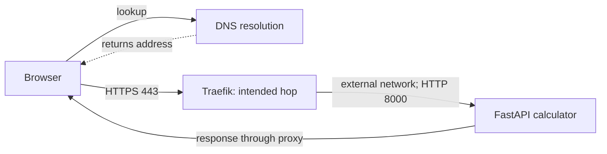
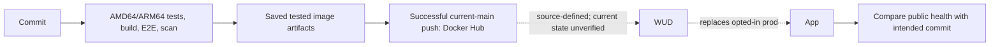

# Existing calculator system — DOC-001

**AI student simulation, October 26, 2026.** Instructor-owned class system; not real student learning evidence.

- **Status / next step:** Keep stage: documentation, isolated app recreation and LEARNING accuracy reviewed. [PR #2](https://github.com/kaw393939/is373-system-map-trial-1026/pull/2) records current integration status; optional next cycle remains separate.
- **Documentation:** [separate trial](https://github.com/kaw393939/is373-system-map-trial-1026), [issue #1](https://github.com/kaw393939/is373-system-map-trial-1026/issues/1), branch `docs/doc-001`.
- **Application:** [is373_ci_cd at 4600202bad42da0c5ffb11d83ce8364671293d3d][app].
- **Hosting:** [373_hosting at 9d828ad1cf3b72d3c6379e074474683eae0cdd8f][hosting].
- **Observed live site:** [calc.mywebclass.org](https://calc.mywebclass.org), October 26, 2026.

## Agreed scope

One calculator host: request path, relevant server components/state and code-change-to-running-release path, then one isolated app recreation. No live deployment, rollback, DNS change, fault or unrelated AI-chat project. Source examples describe intended setup; runtime evidence must be separate.

## A visitor's request

**Initial simulated-learner prediction, before the explanation:** browser looks up the domain and sends the request to the hosting server; unsure what comes between lookup and app. Assistance is recorded in [LEARNING.md](LEARNING.md).

DNS resolves a name; application traffic does not pass through DNS. Public HTTPS/app responses are observed. The middle hops are source-backed by the [adapter][adapter] and [September deployment record][historical]; current labels/network membership were not inspected.

## Components and features

| Feature | Purpose and source | October 26 check / boundary |
| --- | --- | --- |
| DNS and HTTPS | Locate host and secure browser connection; [proxy configuration][hostconfig] intends public80/443 and Let's Encrypt | Resolver succeeded; HTTP308 to HTTPS; trusted HTTPS200. Provider records, firewall/renewal configuration unverified. |
| Traefik routing | [Adapter][adapter] selects external network/Host rule and forwards to8000 | September record used `web`; generator example defaults `hosting-web`. Current network/labels/proxy version unverified. |
| Calculator | [HTTP routes][routes] and [arithmetic][math] serve page, health and four operations | Public6×7:200/result42; divide by0:400/`division_by_zero`. Selected cases, not all-feature coverage. |
| Image and restrictions | [Dockerfile][dockerfile]: pinned base, locked dependencies, UID/GID10001, release metadata. [Compose][compose]: read-only filesystem/capability restrictions | Public health reports production/4600202…/builtOctober1. Actual host imageID/digest and applied restrictions unverified. |
| WUD | [Compose][compose]: only `prod` opted in; digest poll selects moving `prod` and Docker trigger replaces container | Source only for today's updater state; no automatic update exercised. |
| Other hosted sites | [Hosting example][hostconfig]: independent Apache welcome containers share proxy network | Context, not calculator containers. Current site inventory unverified. |
| Lifecycle/recovery | [Runtime wrapper][runtime] loads local override and persisted release selection; deploy/verify/rollback/resume | Source only. None of these production commands ran; single-container replacement can interrupt service. |

## State, startup and recovery

- **Current host metadata:** read-only SSH reported Ubuntu24.04.5 LTS/x86_64. The documented `/opt/is373_ci_cd/{compose.yaml,compose.override.yaml,.env}` files exist; contents were not printed. `sudo -n docker ps` stopped at “a password is required.” No password was requested.
- **Source-defined ports:** proxy80/443 public; app8090→8000 and WUD8091→3000 loopback; development8080 separate. Current bindings unverified.
- **Private state to identify/back up:** hosting certificate store, site content/configuration; app `.env`, `compose.override.yaml`, `.state/release.env`, `.state/updates-paused`, `.state/wud.env`; WUD `wud-data`. Names/purposes from source; contents, current backups and restoration unverified.
- **Startup:** source uses `unless-stopped`; [Make/runtime][runtime] preserves optional override and release selection. Production pulls a published image; development mounts source.
- **Recovery:** source rollback needs a compatible known-good image, pauses updates and persists selection; resume deliberately returns to `prod`. Backup/restore has not been tested.

## Code change to running release

| Stage | Evidence | Boundary |
| --- | --- | --- |
| Checks | [Workflow][workflow]: PR, main push, manual verification; native unit/API/Chromium checks and scans | Scan findings report-only; green does not mean no vulnerabilities. |
| Publication | Only successful current-main push; [publisher][publisher] uploads saved tested images and makes platform tags, commit index and moving `prod` | Actions registry secret is not server SSH access. Tags follow convention; no current digest independently read here. |
| Recorded run | [36904255716][release-run]: expected4600202…; both native jobs, verify and publish successful | Historical run; image artifacts may expire. |
| Host handoff | WUD poll/trigger and [runtime][runtime] deployment/verification controls | Current polling, pause state and update history unverified. Source does not prove host configuration applied. |
| Running identity | [Public health](https://calc.mywebclass.org/health), checked with [verifier][verifier] and expected full commit from the run | HTTPS200/statusok/production/expected commit. Reports service identity, not actual host image digest. |

## Recreation and review

- **Guide:** [docs/recreate.md](docs/recreate.md).
- **Agreed target:** disposable Ubuntu24.04 runner; pinned app source rebuild, restricted loopback18090 container, health/release and two API cases, then own cleanup. No registry push, proxy, live host or socket mount.
- **Actual attempt:** [run40415518240](https://github.com/kaw393939/is373-system-map-trial-1026/actions/runs/40415518240) passed: pinned source rebuilt on Ubuntu24.04, production health/commit matched,6×7 returned42 and division by0 returned400; own resources cleaned up. Source-build imageID f124e763…; build time2026-10-26T22:50:49Z. Full results in the guide; [trial-only helper](scripts/recreate_app.py), [workflow](.github/workflows/recreate.yml).
- **Learner observation / discrepancy / keep decision:** own terminal GET found the same full live commit but October1 build time versus runner October26. Would not claim proxy/networks/updater/backups recreated. During review, learner requested refreshing stale result/observation fields, then keeping the guide because its app-versus-host boundary is clear. Corrected before PR.
- **Full server recreation, public DNS/TLS, state restore and updater exercise:** not performed.

## Open gaps

| Gap | Why it matters | Next useful check |
| --- | --- | --- |
| Host containers/imageID/ports/networks/labels/updater inaccessible | Runtime may differ from examples | Authorized operator selects nonsecret Docker fields/pause status; never paste passwords. |
| Private configuration/backups unavailable | Full recreation cannot be claimed | Owner identifies required paths/purposes, verifies private backup, then an isolated restore. |
| DNS/firewall/renewal unverified | One HTTPS visit does not prove full configuration/recovery | Read-only owner review of provider/firewall and renewal evidence. |
| Published digest not independently recorded now | Source rebuild is not byte-identical artifact | Resolve published platform-compatible release; compare authorized host image identity. |

## Work record

- **Documentation check:** `python3 scripts/check_docs.py` — 0 publication problems; hygiene only.
- **Checker tests:** `python3 -m unittest discover -s tests -v` — 4 passed; checker tests, not server tests.
- **PR / CI:** [PR #2](https://github.com/kaw393939/is373-system-map-trial-1026/pull/2). [Documentation run40416086930](https://github.com/kaw393939/is373-system-map-trial-1026/actions/runs/40416086930) checks implementation/docs head9b6968d before this link-only record update; [current PR checks](https://github.com/kaw393939/is373-system-map-trial-1026/pull/2/checks) show the latest head. The actual app recreation is run40415518240 above.
- **LEARNING accuracy review:** explicit simulated-learner approval on October26 before first excerpt staging/commit/push; permission included documentation PR.
- **Completion scope:** evidence-based documentation and isolated app source recreation; no full server restore claimed. PR records merge status.

[app]: https://github.com/kaw393939/is373_ci_cd/tree/4600202bad42da0c5ffb11d83ce8364671293d3d
[hosting]: https://github.com/kaw393939/373_hosting/tree/9d828ad1cf3b72d3c6379e074474683eae0cdd8f
[adapter]: https://github.com/kaw393939/373_hosting/blob/9d828ad1cf3b72d3c6379e074474683eae0cdd8f/examples/integrations/calculator/compose.traefik.yaml
[historical]: https://github.com/kaw393939/373_hosting/blob/9d828ad1cf3b72d3c6379e074474683eae0cdd8f/book/deployments/2026-09-29-calculator.md
[hostconfig]: https://github.com/kaw393939/373_hosting/blob/9d828ad1cf3b72d3c6379e074474683eae0cdd8f/examples/full-stack/compose.yaml
[routes]: https://github.com/kaw393939/is373_ci_cd/blob/4600202bad42da0c5ffb11d83ce8364671293d3d/app/main.py
[math]: https://github.com/kaw393939/is373_ci_cd/blob/4600202bad42da0c5ffb11d83ce8364671293d3d/app/calculator.py
[dockerfile]: https://github.com/kaw393939/is373_ci_cd/blob/4600202bad42da0c5ffb11d83ce8364671293d3d/Dockerfile
[compose]: https://github.com/kaw393939/is373_ci_cd/blob/4600202bad42da0c5ffb11d83ce8364671293d3d/compose.yaml
[runtime]: https://github.com/kaw393939/is373_ci_cd/blob/4600202bad42da0c5ffb11d83ce8364671293d3d/scripts/runtime.py
[workflow]: https://github.com/kaw393939/is373_ci_cd/blob/4600202bad42da0c5ffb11d83ce8364671293d3d/.github/workflows/ci.yml
[publisher]: https://github.com/kaw393939/is373_ci_cd/blob/4600202bad42da0c5ffb11d83ce8364671293d3d/scripts/publish.py
[release-run]: https://github.com/kaw393939/is373_ci_cd/actions/runs/36904255716
[verifier]: https://github.com/kaw393939/373_hosting/blob/9d828ad1cf3b72d3c6379e074474683eae0cdd8f/scripts/verify-release.py
